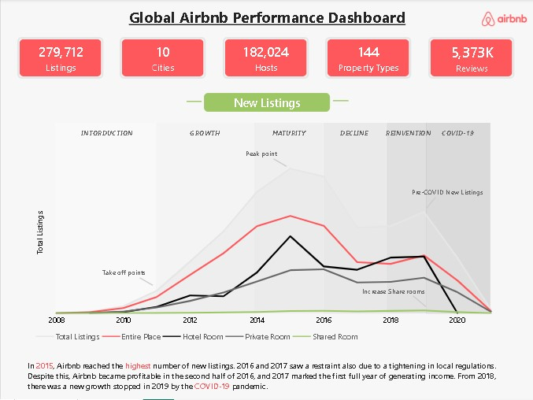
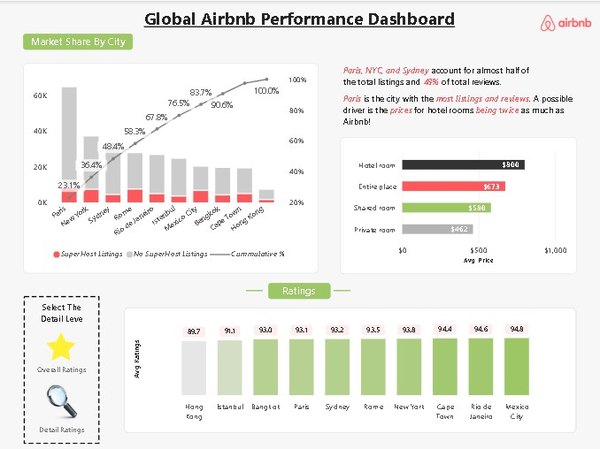
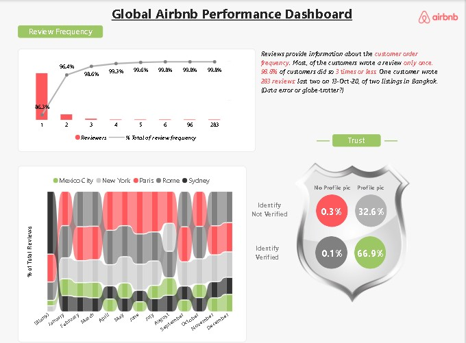

# Airbnb Global Performance Dashboard | Power BI

## Project Overview
This is a learning project built using Microsoft Power BI to explore Airbnb listing data and analyze market performance across different locations.

## Dashboard Highlights
- **Airbnb Overview:** Listing trends, hosts, property types, and reviews.
- **Market Share & Ratings:** City-wise listing distribution, average prices, and ratings.
- **Reviews & Trust:** Review frequency and host profile verification analysis.

## Tools Used
- Microsoft Power BI
- Data visualization
- Interactive dashboard design

## Learning Objectives
- Practice building interactive Power BI dashboards.
- Learn to present KPIs and business metrics visually.
- Explore listing trends, pricing, ratings, and review patterns.

## Project Background
This dashboard was created for learning purposes by following a YouTube tutorial. Credit belongs to the original tutorial creator for the guidance.

**Original tutorial:** [Watch on YouTube](https://youtu.be/LzlaCBNT9vY?si=lNeOMpS5_Xu3B1Bl)

## Files
- Power BI dashboard (`.pbix`)
- Dashboard screenshots

## Future Improvements
I plan to extend this project by developing additional business questions, independent analysis, and new insights.

## Dashboard Preview

### Airbnb Overview

### Market Share and Ratings

### Reviews and Trust

## Download the Power BI Dashboard

Download the `.pbix` file from the [GitHub Releases](../../releases/latest) page.
